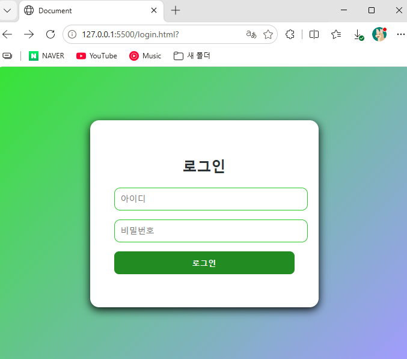
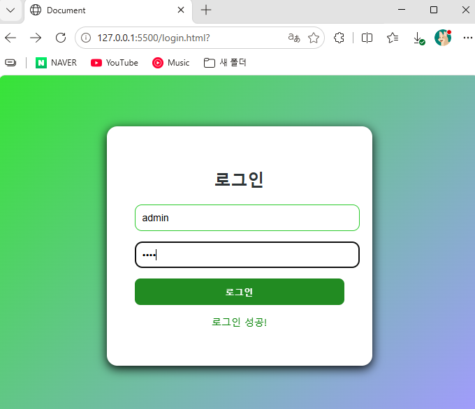
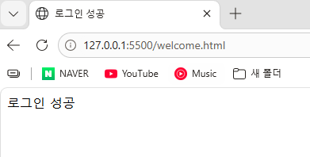
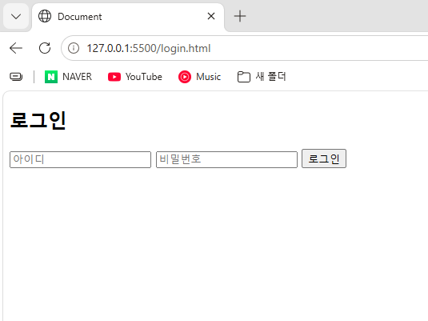

# 웹 서비스 이해 1~6강

2026.10.18

 1. 배운 내용

웹 서비스는 클라이언트가 서버에 요청을 보내고 서버가 처리한 결과를 응답하는 구조로 동작한다.

프론트엔드는 화면을 담당하고 백엔드는 데이터 처리, db는 데이터 저장을 담당한다.

html은 웹페이지의 구조를 만들고 css는 디자인, javascript는 동적인 기능을 담당한다. api는 프론트와 백엔드가 데이터를 주고받기 위한 약속이라고 이해했다.

 2. 실습

vscode에서 html css javascript를 이용해 간단한 로그인 페이지를 만들어봤다.

아이디와 비밀번호가 맞으면 로그인 성공 메시지가 뜨고 다른 페이지로 이동하도록 구현했다.

 3. 트러블슈팅

live server 확장 프로그램이 자동 설치되지 않아 vsix 파일을 직접 받아 수동으로 설치했다.

코드 작성 중 괄호나 세미콜론을 빠뜨려 오류가 발생했는데 잘못된 부분을 수정해서 해결했다.

 4. 느낀점

웹 서비스가 어떻게 동작하는지 전체적인 흐름을 알 수 있었다.

간단한 로그인 화면이지만 직접 만들어보니 html css javascript가 각각 어떤 역할을 하는지 조금 더 이해가 됐다.

 5. 실습 파일

- [login.html](vscode_projcet/front/web/login.html)
- [login.css](vscode_projcet/front/web/css/login.css)
- [login.js](vscode_projcet/front/web/script/login.js)
- [welcome.html](vscode_projcet/front/web/welcome.html)

 6. 실행 결과

**1. 기본 로그인 화면**

**2. css 적용 후 로그인 화면**

**3. 로그인 성공 메시지**

아이디와 비밀번호가 일치하면 로그인 성공 메시지가 표시된다.

**4. 로그인 성공 후 페이지 이동**

로그인에 성공하면 1초 뒤 welcome.html 페이지로 이동한다.

